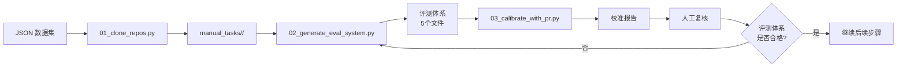

# Refactor 脚本

本目录包含两条主线：

1. **数据合成**（`data_synthesis/`，步骤 1-7）：从数据集下载仓库、用 LLM 生成评测体系。
2. **评测流水线**（`evaluation/`，步骤 1-6）：让 AI 执行重构，再用评测体系打分并生成报告。见下方 [评测流水线](#评测流水线)。

---

## 评测流水线

对同一个重构任务（case），让 AI 模型执行代码重构，再用统一的评测体系（测试 + 硬性门控 + 客观指标 + 评分标准）对结果打分并生成对比报告。

统一入口是 `scripts/evaluation_pipeline.py`，按顺序串联 6 个步骤（对应 `scripts/evaluation/0X_*.py`）：

| 步骤 | 脚本 | 作用 |
|---|---|---|
| 1 | `01_prepare_dataset.py` | 校验 case 完整性（metadata、repo、评测脚本等） |
| 2 | `02_build_image.py` | 用 case 自带 Dockerfile 构建评测镜像并启动容器 |
| 3 | `03_setup_environment.py` | 在容器内搭建并验证运行环境 |
| 4 | `04_run_refactor.py` | 为每个「模型 × 迭代」创建工作空间并执行 AI 重构 |
| 5 | `05_evaluate_and_report.py` | 对重构结果跑测试 + verifier（含硬性门控/客观指标/rubric），生成对比报告 |
| 6 | `06_export_artifacts.py` | 从容器导出评测产物 |

### 常用命令

```bash
# 完整流水线
python scripts/evaluation_pipeline.py --case manual_tasks/xxx

# 覆盖模型与迭代次数（默认读 config.yaml）
python scripts/evaluation_pipeline.py --case manual_tasks/xxx --models claude-opus-4-8 --iterations 3

# 只执行部分步骤（逗号分隔）
python scripts/evaluation_pipeline.py --case manual_tasks/xxx --steps 4,5,6

# 强制重建镜像 + 步骤 4 并行度 3
python scripts/evaluation_pipeline.py --case manual_tasks/xxx --force-rebuild --parallel 3
```

### 参数

| 参数 | 说明 |
|---|---|
| `--case`（必需） | case 路径，如 `manual_tasks/xxx` |
| `--models` | 模型列表，覆盖 `config.yaml`，如 `claude-opus-4-8` |
| `--iterations` | 每个模型的迭代次数，覆盖 `config.yaml` |
| `--steps` | 要执行的步骤，逗号分隔（默认 `1,2,3,4,5,6`） |
| `--parallel` | 步骤 4 重构并行度，覆盖 `config.yaml` |
| `--verifier-runs` | 步骤 5 verifier 固定运行次数，覆盖 `config.yaml` |
| `--force-rebuild` | 步骤 2 强制重建镜像（`--no-cache`） |
| `--interactive` | 步骤 3 交互模式（手动在容器里操作） |
| `--include-agent-logs` | 步骤 6 导出时包含 `agent_session/` 日志 |
| `--config` | 指定配置文件路径（默认 `scripts/evaluation/config.yaml`） |

### 重新评测已有的重构结果

改了评测脚本（`verifier.py` / `hard_gates.py` / `objective_metrics.py` / `rubric.py`）后，想对**已经跑完的 AI 重构结果**重新打分——**不需要重新跑 AI 重构**。

重构产物保存在容器 `/workspace/candidates/<工作空间>/repo` 里，重评只是对这些已有产物重新跑评测。只需重跑步骤 5：

```bash
python scripts/evaluation_pipeline.py --case manual_tasks/xxx --steps 5
```

**评测脚本如何进容器**：步骤 5 在容器内运行 `/workspace/verifier.py`（它再调用 `/workspace/hard_gates.py` 等）。这些脚本原本是构建镜像时从 case 目录 COPY 进去的。为避免"改了 case 目录里的脚本，但容器里还是旧版"，**步骤 5 每次运行前会自动把 case 目录里的最新评测脚本 `docker cp` 进容器**（覆盖镜像内旧版）：`verifier.py`、`hard_gates.py`、`objective_metrics.py`、`rubric.py`。

所以典型的"改门控 → 重评"流程是：

```bash
# 1. 编辑 case 目录里的门控脚本，如 manual_tasks/xxx/hard_gates.py

# 2. 重跑步骤 5（自动同步脚本进容器，再对历史重构结果重新打分）
python scripts/evaluation_pipeline.py --case manual_tasks/xxx --steps 5
```

这比 `--force-rebuild` 重建镜像快得多（秒级 vs 分钟级），而且**不会重启容器、不会丢掉容器里已有的重构产物**。

> ⚠️ 不要用 `--steps 2 --force-rebuild` 来"更新脚本"——重建镜像会重启容器并丢失 `/workspace/candidates` 里的历史重构产物，那样就得连 AI 重构一起重跑了。

### verifier 多次运行

步骤 5 的 verifier 会**固定跑满 N 次**（默认取 `config.yaml` 的 `verifier_runs`），每次原始输出都独立落盘、互不覆盖，供步骤 6 导出。用于观察测试稳定性。

```bash
python scripts/evaluation_pipeline.py --case manual_tasks/xxx --steps 5 --verifier-runs 3
```

### 配置（`scripts/evaluation/config.yaml`）

```yaml
agent:
  vendors:
    claude:
      - claude-opus-4-8   # 要评测的模型
  iterations: 3           # 每个模型的迭代次数

verification:
  verifier_runs: 3        # 步骤 5 verifier 固定运行次数
```

命令行参数优先级高于 `config.yaml`。

### 报告位置

- 评测报告：`manual_tasks/xxx/results/evaluation/<批次时间戳>/`
- 重构结果：`manual_tasks/xxx/results/refactor/`

每次评测按时间戳隔离成一个批次，不会互相覆盖。

---

## 数据合成

自动化 refactor 数据合成流程的工具脚本集合。

## 目录结构

```
scripts/
├── data_synthesis/                # 数据合成脚本（步骤1-7）
│   ├── 01_clone_repos.py          # 步骤1: 下载代码仓库
│   ├── 02_generate_eval_system.py # 步骤2: 生成评测体系
│   ├── 03_calibrate_with_pr.py    # 步骤3: 校准评测体系
│   ├── 04_generate_prompt.py      # 步骤4: 生成 prompt.md
│   ├── 05_audit_tests.py          # 步骤5: 审计并补充测试
│   ├── 06_generate_setup.py       # 步骤6: 生成 setup.py
│   └── 07_generate_dockerfile.py  # 步骤7: 生成 Dockerfile
├── data_synthesis_pipeline.py     # 数据合成流水线（串联步骤1-7）
├── prompts/                       # 提示词模板
├── templates/                     # 代码模板
└── utils/                         # 工具函数
```

## 快速开始

### 1. 环境配置

```bash
source .venv/bin/activate

# 安装依赖
pip install -r requirements.txt

# 配置 API
cd scripts
cp .env.example .env
# 编辑 .env，填入你的 OpenAI API key 和 base URL
```

### 2. 使用流水线（推荐）

**一键执行所有数据合成步骤：**

```bash
# 执行步骤 1-7（完整流程）
python scripts/data_synthesis_pipeline.py --number xxxx
```

**执行特定步骤：**

```bash
# 只执行步骤 2-4
python scripts/data_synthesis_pipeline.py --case manual_tasks/xxx --steps 2,3,4
```

### 3. 手动执行单个步骤

```bash
# 步骤1: 下载代码仓库
python scripts/data_synthesis/01_clone_repos.py --number 16013

# 步骤2: 生成评测体系
python scripts/data_synthesis/02_generate_eval_system.py --case manual_tasks/xxx

# 步骤3: 校准评测体系
python scripts/data_synthesis/03_calibrate_with_pr.py --case manual_tasks/xxx

# 步骤4: 生成 prompt.md
python scripts/data_synthesis/04_generate_prompt.py --case manual_tasks/xxx

# 步骤5: 审计并补充测试
python scripts/data_synthesis/05_audit_tests.py --case manual_tasks/xxx

# 步骤6: 生成 setup.py
python scripts/data_synthesis/06_generate_setup.py --case manual_tasks/xxx

# 步骤7: 生成 Dockerfile
python scripts/data_synthesis/07_generate_dockerfile.py --case manual_tasks/xxx
```

## 脚本概览

| 脚本 | 功能 | 状态 | 输出文件 |
|------|------|------|----------|
| `data_synthesis_pipeline.py` | **数据合成流水线** | ✅ 完成 | 串联执行步骤1-7 |
| `01_clone_repos.py` | 下载代码仓库和任务描述 | ✅ 完成 | `manual_tasks/{case}/repo/` |
| `02_generate_eval_system.py` | 生成评测体系 | ✅ 完成 | `metadata.json`, `verifier.py`, `hard_gates.py`, `objective_metrics.py`, `rubric.py` |
| `03_calibrate_with_pr.py` | 用真实 PR 验证评测体系 | ✅ 完成 | `calibration/` 目录 |
| `04_generate_prompt.py` | 生成 prompt.md | ✅ 完成 | `prompt.md` |
| `05_audit_tests.py` | 审计并补充单元测试 | ✅ 完成 | `tests_audit.md`, `candidate_tests.patch` |
| `06_generate_setup.py` | 生成 setup.py | ✅ 完成 | `setup.py` |
| `07_generate_dockerfile.py` | 生成 Dockerfile | ✅ 完成 | `Dockerfile` |

**功能**：从数据集下载指定任务的代码快照和描述。

**用法**：
```bash
# 下载单个任务
python3 scripts/01_clone_repos.py --number 2764

# 下载多个任务
python3 scripts/01_clone_repos.py --numbers 2764,16013,57

# 下载某个范围的任务
python3 scripts/01_clone_repos.py --numbers 1-10
```

**输出**：
```
manual_tasks/<repo>__<number>/
├── repo/              # 代码仓库快照
├── refactor.md        # 任务描述（issue/PR body）
└── metadata.json      # 基础元信息
```

**metadata.json 字段**：
```json
{
  "number": 2764,
  "title": "任务标题",
  "full_name": "milvus-io/pymilvus",
  "url": "https://github.com/.../issues/2764",
  "commit_id": "d36851e...",      // base commit
  "pr_commit_sha": null,           // PR commit（issue 为 null）
  "merge_commit_sha": null,        // merge commit（issue 为 null）
  "refactor_type": "interface_type_refactor",
  "language": "Python"
}
```

---

### 02_generate_eval_system.py - 生成评测体系

**功能**：使用 LLM 读取代码仓库和任务描述，生成完整的评测体系。

**用法**：
```bash
python3 scripts/02_generate_eval_system.py --case manual_tasks/<task_dir>
```

**生成文件**：
1. **metadata.json**（详细版）- 补充任务意图、范围、测试命令等
2. **hard_gates.py** - 硬门控（一票否决项）
3. **objective_metrics.py** - 客观指标（复杂度、重复度等）
4. **verifier.py** - 评测编排脚本
5. **rubric.py** - 评分标准（主观质量判断）

**生成流程**：
1. 调用 LLM 补充 metadata
2. 调用 LLM 生成 hard_gates + objective_metrics + verifier
3. 调用 LLM 生成 rubric

**配置**：
- 提示词模板：`scripts/prompts/*.txt`
- LLM 配置：`scripts/.env`（TEXT_MODEL）
- 工具函数：`scripts/utils/`

---

### 03_calibrate_with_pr.py - 用真实 PR 验证评测体系

**功能**：将真实 PR 的 patch 作为候选结果，运行 verifier 3 次，生成校准报告。

**详细文档**：[README_03.md](README_03.md)

**用法**：
```bash
python3 scripts/03_calibrate_with_pr.py --case manual_tasks/<task_dir>
```

**前置条件**：
- 任务目录必须包含 `verifier.py`、`hard_gates.py`、`objective_metrics.py`、`rubric.py`
- 必须有 `reference_pr.patch`（真实 PR 的代码变更）

**输出目录**：
```
<task_dir>/calibration_<timestamp>/
├── run_1.json                  # 第 1 次运行结果
├── run_2.json                  # 第 2 次运行结果
├── run_3.json                  # 第 3 次运行结果
├── calibration_report.json     # 校准报告（JSON）
└── calibration_analysis.md     # 校准分析（Markdown）
```

**校准报告内容**：
- 硬门控通过情况（每个门控的 pass/fail/na 状态）
- 客观指标对比（baseline → candidate）
- Rubric 评分明细
- 一致性检查（3 次运行是否稳定）
- 发现的问题和建议

---

## 项目结构

```
scripts/
├── .env                        # API 配置
├── 01_clone_repos.py           # 第一步脚本
├── 02_generate_eval_system.py # 第二步脚本
├── 03_calibrate_with_pr.py    # 第三步脚本
├── prompts/                    # LLM 提示词模板
│   ├── metadata_generation.txt
│   ├── verifier_generation.txt
│   └── rubric_generation.txt
├── utils/                      # 工具模块
│   ├── llm_client.py          # LLM API 封装
│   ├── context_collector.py  # 代码上下文收集
│   └── prompt_loader.py       # 提示词加载器
├── README.md                   # 本文件
├── README_03.md                # 第三步详细文档
└── requirements.txt            # Python 依赖
```

## 数据流



## 配置说明

### .env 文件

```bash
# LLM API 配置
BASE_URL=https://api.example.com/v1
API_KEY=your_api_key_here

# 模型选择
TEXT_MODEL=gpt-4  # 用于生成评测体系的模型
```

### 提示词模板

提示词模板存放在 `scripts/prompts/` 目录：
- `metadata_generation.txt` - metadata.json 生成提示词
- `verifier_generation.txt` - hard_gates + objective_metrics + verifier 生成提示词
- `rubric_generation.txt` - rubric.py 生成提示词

模板使用 Python `str.format()` 语法，支持以下占位符：
- `{directory_tree}` - 代码仓库目录树
- `{refactor_md}` - 任务描述
- `{config_files_section}` - 配置文件内容
- `{metadata_json}` - metadata.json 内容

## 常见问题

### Q: 如何处理 issue case（没有真实 PR）？

**A**: Issue case 只能完成前两步：
1. 下载代码和任务描述（第一步）
2. 生成评测体系（第二步）
3. 跳过校准（第三步，因为没有 reference_pr.patch）
4. 直接进入第四步（生成 prompt.md）

### Q: 如何获取真实 PR 的 patch？

**A**: 对于有真实 PR 的 case：
1. 第一步会记录 `pr_commit_sha` 到 metadata.json
2. 如果 repo/ 有 .git 目录，可以运行：
   ```bash
   cd manual_tasks/<task>/repo
   git diff <base_commit>..<pr_commit> > ../reference_pr.patch
   ```
3. 或者从 GitHub API 获取：
   ```bash
   curl -H "Accept: application/vnd.github.v3.diff" \
        https://api.github.com/repos/<owner>/<repo>/pulls/<number> \
        > reference_pr.patch
   ```

### Q: 校准失败怎么办？

**A**: 查看 `calibration_analysis.md`，根据失败的硬门控：
1. **patch_applicable** 失败：检查 patch 格式和路径
2. **build_pass** 失败：检查依赖安装和构建命令
3. **regression_pass** 失败：检查测试命令和环境
4. **behavior_oracle_pass** 失败：检查特定测试用例和依赖

然后修改对应的 `hard_gates.py`，重新运行第三步。

### Q: 如何并行处理多个任务？

**A**: 脚本目前是单线程的。如需并行：
```bash
# 方案 1：手动并行
python3 scripts/02_generate_eval_system.py --case manual_tasks/task1 &
python3 scripts/02_generate_eval_system.py --case manual_tasks/task2 &
wait

# 方案 2：使用 GNU parallel
parallel python3 scripts/02_generate_eval_system.py --case ::: manual_tasks/*
```

## 开发

### 添加新脚本

1. 在 `scripts/` 下创建脚本文件
2. 使用 `utils/` 中的工具模块
3. 遵循现有脚本的参数和输出格式
4. 更新本 README

### 修改提示词

直接编辑 `scripts/prompts/*.txt`，无需修改代码。

### 调试

```bash
# 查看 LLM 调用日志
export DEBUG=1
python3 scripts/02_generate_eval_system.py --case <task>

# 使用更便宜的模型测试
# 修改 .env: TEXT_MODEL=gpt-3.5-turbo
```

## 参考

- 完整工作流文档：`docs/工作流文档/refactor_workflow_v0.1.md`
- 数据集：`refactor_standard_20260427_061924_600items.json`
- 第三步详细文档：[README_03.md](README_03.md)
